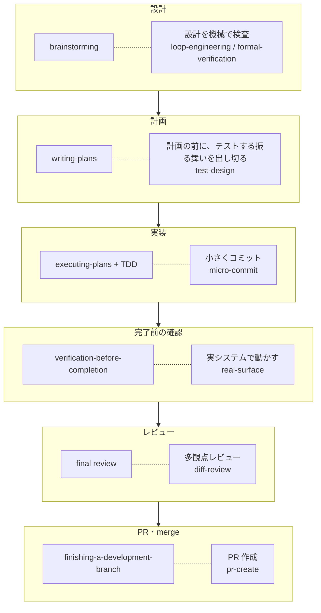
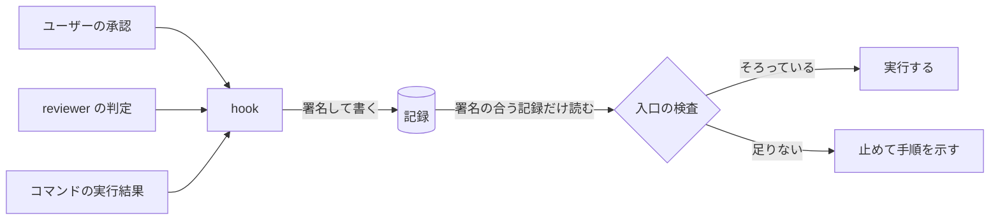

# hymme

[superpowers](https://github.com/obra/superpowers) に検証と運用を足す Claude Code プラグイン。

- 工程は superpowers が決める。hymme は各工程に検証と git・レビューの運用を差し込む。
- 検証は3系統ある。設計の検査(TLA+、Z3)、テスト設計、証明(Lean 4)。
- 守らせたい規則は hook が検査する。満たさなければ、検証や PR の作成を止める。
- 必要なツール(TLA+、Apalache、Z3、Lean)は Nix の flake で配る。

どの工程でどのスキルを使うかは `using-hymme` スキルに書いてあり、セッションの開始時に自動で読み込まれる。

## 全体の流れ

枠が工程。枠の中の左が superpowers のスキル、右が hymme の足す部分。



## superpowers との役割分担

| 局面 | superpowers | hymme が足すもの |
| --- | --- | --- |
| 設計 | brainstorming | loop-engineering(設計の検査)、formal-verification の性質カタログ(証明する性質の一覧) |
| 設計の確認 | brainstorming の承認 | 検証の前に、何を実証するかの一覧をユーザーが承認する |
| 計画 | writing-plans | test-design の T-ID 台帳(テストする振る舞いの一覧)。設計書の承認後に作り、Task に落とす |
| 実装 | executing-plans / subagent-driven-development、test-driven-development | 既定は executing-plans(subagent に任せず、本体のセッションで実装)。証明は prover、モデル検査は modeler に任せられる |
| コミット | 規約なし | commit-flow(粒度)、micro-commit(実行) |
| 完了 | verification-before-completion | real-surface(実システムで確かめる)。TLA+ の spec がある設計は実ログと突き合わせる |
| レビュー | final review | diff-review(多観点)。変更がブランチの外へ出る前に hook が記録を確かめる |
| PR | finishing-a-development-branch | pr-create |
| バグ | systematic-debugging | gh-ci-investigate(CI のログ集め)、escape-flow(欠陥を前の段で拾えるようにする) |
| 訂正 | receiving-code-review | review-feedback(同種の穴を探し、再発を防ぐ) |
| 台帳 | plan 実行の ledger | ledger-flow(それ以外の進捗・引き継ぎ文書) |
| 履歴 | using-git-worktrees | rebase-flow / reset-flow と git-guard hook |

superpowers と食い違う箇所の読み替えも `using-hymme` にある。例は plan の「SDD 推奨」、brainstorming の承認後の手順、finishing からの PR 作成。

## インストール

superpowers が前提。hymme の marketplace から両方インストールする。

```
/plugin marketplace add Hakkadaikon/hymme
/plugin install superpowers@hymme
/plugin install hymme@hymme
```

- superpowers は `superpowers@claude-plugins-official` でインストールしても同じ。
- superpowers は**どちらか一方だけ**インストールする。両方インストールすると、スキルとセッション開始時の hook が二重になる。
- 動作を確かめたのは superpowers 7.0.0。sha は固定していない。`/plugin update superpowers@hymme` で上流に追従する。
- `hymme` コマンドと検証のツールは、下の「ツールチェイン」でインストールする。検証を使わなくても `hymme` コマンドは要る。

hymme の更新は次の2つ。自動更新は無効。反映には再起動が要る。

```
/plugin marketplace update hymme
/plugin update hymme@hymme
```

## 収録スキル

検証系は「ルーターのスキル + 工程のスキル」でできている。

- ルーターが局面を見て、工程のスキルへ振り分ける。
- スキルの一覧に出るのはルーターだけ。工程のスキルと個別のテスト技法は、ルーターの指示でファイルを読んで使う。
- こうすると一覧が短くなり、説明文が切り捨てられない。

### 検証

太字がルーター。

| 系統 | スキル | すること | ツール |
| --- | --- | --- | --- |
| loop-engineering | **loop-engineering** | 要求を TLA+ で検査できる設計にする | |
| | loopeng-extract | 要件を出し切る | |
| | loopeng-formalize | 要件を EARS(要求を書く定型文)と状態モデルに整理し、TLA+ の spec にする | `loop-outer` |
| | loopeng-modelcheck | TLC で spec の全状態を検査する | `loop-middle` |
| | loopeng-gherkin | 反例を Gherkin(受け入れ仕様の書式)にする | `loop-inner` |
| | loopeng-smt | 状態を持たない判定が、どんな入力でも成り立つかを Z3 で検査する | `smt_oracle.py` |
| | loopeng-tracecheck | 実装後に、実システムのログを spec に流す | `trace_check.py` |
| 検証の前 | **verifiability** | 検証する判定を小さな純粋関数に切り出す | `verifiability.py` |
| test-design | **test-design** | テスト設計と既存テストのレビュー | |
| | test-extract | テストする振る舞いを出し切り、台帳にする | |
| | test-catalog | 振る舞いごとに、40のテスト技法から手法を選ぶ | |
| | test-verify | 実装への橋渡し、実行の確認、回帰の固定 | |
| formal-verification | **formal-verification** | 仕様を Lean 4 で書いて証明し、証明した性質を test-first の実装へ渡す | `lake` |

補足。

- loopeng-extract は信頼境界ごとに、STRIDE の6観点で異常系を確かめる。入力のパースや長さの計算があれば CWE Top 25 も見る。
- loopeng-extract は依存先や先行研究の原文を集めるのに [imozuru](https://github.com/MaryCache/imozuru) を使う(入っていれば。任意)。
- loopeng-modelcheck と loopeng-smt は、わざと壊した版も検査する。検査が効いていることを確かめるため。
- loopeng-modelcheck と formal-verification は、最後に別の読み手が spec や定理を平文に戻す。それを要件と比べる。
- loopeng-tracecheck は、spec の許さない遷移を見つける。
- verifiability は、指標(複雑度・行数・引数・副作用など)を閾値まで直す。

### 開発の運用

| スキル | すること |
| --- | --- |
| **diff-review** | 差分を複数の観点でレビューする。`conformance` の観点は、実装が不変条件を全経路で守るかを論証させる |
| **commit-flow** | コミットの粒度を決め、計画する |
| **micro-commit** | 変更を30〜50行ほどの単位に分け、Conventional Commits で続けてコミットする |
| **test-targeted** | 変更に関係するテストだけを実行する |
| **gh-ci-investigate** | GitHub Actions の失敗を調べる |
| **review-feedback** | レビュー指摘や自分で見つけた失敗を直す。原因を調べ、同種の穴を探し、再発を防ぐ |
| **ledger-flow** | 進捗の台帳と引き継ぎ文書の書き方 |
| **rebase-flow** / **reset-flow** | 履歴を壊す操作の安全な手順。手順を踏まない実行は git-guard hook が止める |
| **pr-create** | PR を作る |
| **escape-flow** | 後段で見つかった欠陥と報告されたバグを、拾えたはずの前の段へ戻す |
| **real-surface** | 実システムの動かし方をリポジトリごとに決め、完了前に実システムで確かめる |

段は前から spec、unit、integration、e2e、trace(実ログ)、ci。後段は integration 以降(integration を含む)。

escape-flow では前の段にテストを足す。

- そのテストが修正前に失敗し、修正後に通ることをツールが確かめる。
- 確かめが済むまで、変更は統合できない。

テストを足せない欠陥は、抜けた理由ごとにユーザーの承認を取る。そのあと `hymme escape verify` を実行すると閉じる。

| 抜けた理由 | 取る承認 |
| --- | --- |
| 前段では原理的に拾えない | `hymme escape unreachable` で申請する |
| 要件の抜け、モデルで捨てた領域 | 要件と確認の一覧を直し、`hymme claims request` で承認を取り直す |

過剰設計だけを見るレビューは、[ponytail](https://github.com/DietrichGebert/ponytail) の ponytail-review を使う(任意)。

```
/plugin marketplace add DietrichGebert/ponytail
/plugin install ponytail@ponytail
```

### agents

`hymme:<name>` で呼ぶ。

| agent | すること |
| --- | --- |
| **modeler** | TLA+ のモデル検査。1つの spec に集中する |
| **prover** | Lean 4 の証明。1つの性質に集中する |
| **diff-reviewer** | diff-review のワーカー |
| **verification-reviewer** | 検証3系統と verifiability の成果物を、完了前に外から検査する |

- modeler と prover の結果は、呼び出し元が verification-reviewer に渡す。
- verification-reviewer は `skills/<スキル>/reviewer.md` を読んで検査する。合格が返るまで往復する(`skills/_shared/reviewer-loop.md`)。
- 実装担当の agent は無い。計画は本体が実行する(superpowers:executing-plans)。

subagent を使うのは、次のどれかに当たるときだけ(`skills/_shared/parallel-delegation.md`)。

- 文脈が膨らんで、本体の判断が鈍る。
- 捨ててよい文脈で、並列に回したい。
- 指示やツールが、本体と両立しない。

## 強制のしくみ

合格の根拠になるのは、hook が書いた署名つきの記録だけ。エージェントが台帳に付けたチェックは、根拠にならない。

ここでは2つの語を使い分ける。

- ユーザー: Claude Code を使う人。
- エージェント: 作業している AI。



| 部品 | 場所 |
| --- | --- |
| 記録 | git の共通ディレクトリ(`.git/hymme/`)。別の worktree からも同じものが見える |
| 署名の鍵 | `CLAUDE_PLUGIN_DATA`。hook だけが使う |
| hook のエントリポイント | `hooks/hymme_hook.py` |
| hook の本体 | `loopeng/lib/hymme/` |
| 個別の検査の hook | `hooks/` の `verifiability-gate.sh`、`loopeng-lint-gate.sh`、`git-guard.sh`、`test-design-extract-gate.sh` |

### 入口

検査が掛かる場所は2つある。

検証の入口。

- `loop-*`、`smt_oracle.py`、`trace_check.py`
- `tasks/fv` での `lake build`
- `tlc` と `apalache-mc` の直接の実行

統合の入口。

- `gh pr create`、`glab mr create`
- API や MCP での PR 作成
- 既定のブランチへの `git merge`
- 既定のブランチからの `git push`
- PR 作成後の `git push`

### 規則と手段

| 規則 | 強制する手段 | 止まる場所 |
| --- | --- | --- |
| 検証の前に、何を実証するかをユーザーが承認する | ユーザーの入力(`承認 <承認コード>`。承認コードは申請ごとの8桁)を hook が記録する。一覧を変えると失効する | 検証の入口 |
| 抽出の台帳を閉じてから検証する | 台帳の未チェック・欠番・空の行を hook が読む | 検証の入口 |
| 検証する判定を小さな純粋関数にする | `verifiability.py` の指標 | 検証の入口 |
| 切り出しを reviewer が確かめる | reviewer の判定を hook が記録する。台帳か対象のコードを変えると失効する | 検証の入口 |
| 同じ規則で2回落ちたら、前提を書いて確かめる | 実行の記録(落ちた規則と spec のハッシュ) | 検証の入口 |
| 検査の結果と状態遷移図をユーザーが承認する | `hymme chart draw` の結果と、ユーザーの承認の記録 | 実ログの突き合わせ、統合の入口 |
| 変更をレビューしてから外へ出す | reviewer の `must:` `lenses:` `claim_only:` を hook が記録する。記録は変更の ID(patch-id)に結び付く | 統合の入口 |
| 後段で見つかった欠陥は、前の段で拾えるようにする | 後段のコマンドが失敗すると、欠陥の記録が開く。`hymme escape verify` が、足したテストかユーザーの承認を確かめて閉じる | 統合の入口 |
| 欠陥の修正には、欠陥の記録を付ける | `fix` 型のコミットがあるブランチに、そのブランチの上で開いた記録があるかを hook が読む | 統合の入口 |
| どのコマンドとパスがどの段かを宣言する | `tasks/stages.md` を hook が読む | 統合の入口 |
| 検証の対象にしたコードを変えたら、検証をやり直す | verifiability の台帳の対象と、差分の突き合わせ | 統合の入口 |
| 実装が設計どおりかを実ログで確かめる | 4種のログ(正常系・高負荷・障害注入・わざと壊した実装)を突き合わせた記録 | 統合の入口 |
| 実システムで動かして確かめる | `tasks/surface.md` の確認のコマンドが通った記録 | 統合の入口 |
| 検査を弱める変更は、ユーザーが例外として認める | 差分の skip の追加と、アサーションの削除を読む | 統合の入口 |
| PR の本文に、影響の範囲と検証を書く | 本文の見出しを hook が読む | 統合の入口 |
| 履歴を壊す操作は、手順を踏む | 手順を踏んだ印(arm)を git-guard が読む | git のコマンド |
| テストを書く前に、テストする振る舞いを出し切る | T-ID 台帳の未チェック・欠番 | テストファイルの編集 |

補足。

- 欠陥の記録が自動で開くのは、`tasks/stages.md` で宣言した後段のコマンドが失敗したとき。その段のテストを変えているブランチでは開かない。閉じていない記録があるあいだも、新しくは開かない。
- 実ログは `hymme capture` で採る。わざと壊した実装のログは、不一致になれば合格。
- PR の本文の検査は、hook が本文を読めたときだけ掛かる。`.github/` に PR のテンプレートがあれば見ない。

### どのリポジトリに掛かるか

統合の入口の検査は、リポジトリによって掛かる範囲が違う。

| 検査 | 掛かるリポジトリ |
| --- | --- |
| レビューの記録、欠陥の記録、検査を弱める変更 | すべて |
| 検証のやり直し、実ログ、状態遷移図、段の宣言、実システムでの確かめ、PR の本文 | hymme の台帳を持つリポジトリだけ |

「台帳を持つ」とは `tasks/` に loopeng、fv、verifiability、test-design、stages.md、surface.md のどれかがあること。

### 例外

統合の入口の検査は、申請してユーザーが承認すれば外せる。期限は最長90日。

```sh
hymme exception request <検査> --until <日付> --reason <理由>
```

`<検査>` に書ける名前。

| 名前 | 外す検査 |
| --- | --- |
| `review` | レビューの記録 |
| `fix_without_escape` | `fix` 型のコミットの、欠陥の記録 |
| `weaken` | 検査を弱める変更 |
| `stale` | 検証のやり直し |
| `trace` | 実ログの突き合わせ |
| `stages` | 段の宣言 |
| `surface` | 実システムでの確かめ |
| `pr_body` | PR の本文の見出し |

これ以外は外せない。たとえば次の検査。

- 検証の入口の検査(ユーザーの承認を含む)
- 閉じていない欠陥の記録の検査
- git-guard と、テストファイルの編集の検査

### 手段の無い規則

強制する手段を持たない規則は、スキルの文面にだけある。同じ規則が2回破られたら、文面を足す前に、上の表へ載せられる手段を作る(review-feedback の手順)。

### 限界

- 署名の鍵はユーザーのホームにある。エージェントが意図して読み出せば、記録を偽造できる。
- reviewer を起動するのはエージェントなので、依頼文で判定を誘導できる。
- スクリプトの中から呼ばれた検証は hook から見えない。
- Web の画面で作った PR は hook から見えない。

## ツールチェイン(Nix)

スキルは次のツールを外部コマンドとして呼ぶ。flake がまとめて配る。

- TLA+(TLC、SANY)と Apalache
- python3(Z3 と lizard 入り)と make
- Lean(elan 経由)

### Nix でのインストール

Nix が無いときは、スクリプトが先に Determinate Nix をインストールする。

- システム全体への変更なので、実行前に確認を求める。
- 確認を省くには `HYMME_ASSUME_YES=1` を付ける。

```sh
./scripts/bootstrap.sh          # ツールを PATH に載せた開発用シェルに入る
./scripts/bootstrap.sh install  # profile にインストールして、常に使えるようにする
```

Nix があるなら、直接実行してもよい。

```sh
nix develop
nix profile install .#skill-tools
```

### 使えるようになるもの

| 種類 | コマンド |
| --- | --- |
| 検証のツール | `tlc`、`sany`、`apalache-mc`、`lake`、`lean` |
| `loopeng/bin` のスクリプト | `loop-outer`、`loop-middle`、`loop-inner`、`smt_oracle.py`、`trace_check.py`、`verifiability.py` など |
| `hymme` コマンド | 承認の申請、欠陥の記録、状態遷移図、ログの採取 |

注意が2つある。

- プラグインと `skill-tools` は同じバージョンにそろえる。食い違うと承認が記録されない。
- `skill-tools` が無いと、対象コードのある検証は止まる。検査が `verifiability.py` を PATH から呼ぶため。

### TLC の前の静的検査

`loopeng/bin/tla_lint.sh` が次の2つを通す。

- SANY の構文・意味解析
- `@type:` 注釈がある spec の、Apalache の型検査

`loop-middle` と `loop-inner` はこれを自動で通す。

`tlc` を直接実行して spec のエラーが表示されたら、hook(`hooks/loopeng-lint-gate.sh`)が止めている。エラーを直して、やり直す。

### TLA+ と Apalache のバージョン

nixpkgs に公式のパッケージが無いので、flake は固定したリリースの成果物を取得し、JDK でラップする。バージョンを上げるときは、`flake.nix` の URL とハッシュを一緒に更新する。

v1.8.0 の `tla2tools.jar` には注意が要る。

- 症状: 差し替えが続く先行版なので、ハッシュの不一致でビルドが止まることがある。
- 対処: 新しいハッシュを GitHub のリリース資産のダイジェストと照合してから付け直す。
- 理由: 取得経路の改ざんと区別するため。

### 含めていないもの

必要になったプロジェクトで、個別にインストールする。

| ツール | インストール方法 |
| --- | --- |
| Gherkin のランナー | `cucumber-js`(npm)や `godog`(`go install`)。nixpkgs に無い |
| 要求の追跡用の `doorstop` | `uv pip install doorstop` |

## hymme 自体の開発

### 検査

| 検査 | コマンド | 見るもの |
| --- | --- | --- |
| 静的検査 | `scripts/lint.sh` | ruff(解析と整形)、shellcheck、shfmt、メッセージのコードが対応表にあること。`--fix` で自動修正を書き戻す |
| 回帰テスト | `nix flake check` | 下の一覧と、静的検査 |
| 実システムでの確かめ | `bash scripts/real-session.sh` | 実際の Claude Code のセッションで、hook が止めること |

- 静的検査の対象は `hooks/`・`loopeng/`・`scripts/`・`skills/` 以下の `*.py` と `*.sh`。設定は `ruff.toml` と `.editorconfig`。
- 静的検査のツールは `nix develop` に入っている(`skill-tools` には無い)。
- 実システムでの確かめは Claude Code が要り、トークンを少し使う。そのため `nix flake check` には入れていない。
- `nix flake check` は GitHub Actions(`.github/workflows/check.yml`)でも回す。

`nix flake check` が走らせる回帰テスト。

| テスト | 見るもの |
| --- | --- |
| `scripts/loopeng-lint.test.sh` | TLC の前の静的検査と、spec を壊す検査の分類 |
| `scripts/loopeng-smt-oracle.test.sh` | SMT の判定 |
| `scripts/loopeng-trace-check.test.sh` | 実ログの突き合わせ |
| `scripts/loopeng-tools.test.sh` | loop のツール |
| `scripts/test-design-extract-gate.test.sh` | test-design の抽出の検査 |
| `scripts/verifiability.test.sh` | 検証容易性の指標と検査 |
| `scripts/hymme-core.test.sh` | hook と検査、`hymme` コマンド。`loopeng/lib/tests` の単体テストも回す |
| `scripts/git-guard.test.sh` | git-guard |
| `scripts/check-doc-refs.test.sh` | 文書の参照(`hymme:<name>`、相対リンク、`${CLAUDE_PLUGIN_ROOT}/...`)が実在すること |
| `scripts/check-reviewer-checklist.test.sh` | `skills/*/reviewer.md` の見出しとチェックリストの対応 |
| `scripts/session-start.test.sh` | セッション開始時に読み込む地図の展開 |
| `scripts/collect-diff.test.sh` | diff-review の差分の収集 |

検査を足すときは、通す例と止める例のテストを書く。`flake.nix` の checks と、この一覧にも載せる。

### 決まり

| 対象 | 決まり |
| --- | --- |
| 端末に出すメッセージ | 日本語で書く。各スクリプトの先頭近くの対応表から引く(Python は `MESSAGES` と `msg()`、シェルは `msg()` の case) |
| `loopeng/Makefile.loopeng` | 対応表を置かず、日本語の echo を直接書く。make のレシピなので、静的検査の対象外 |
| 訳さないもの | 判定の値(HOLDS、VIOLATED)と、他のプログラムやスキルが目印として読むトークン |
| hook の中の Python | `python3 -I` で動かす。作業中のリポジトリにある `json.py` などを読み込まないため |
| `skills/*/reviewer.md` | 編集したら `nix flake check` を通す |

日本語の用語は `docs/ubiquitous-language.md` に合わせる。

hymme 自身の段の宣言は `tasks/stages.md`、実システムの定義は `tasks/surface.md` にある。

## 謝辞

次の考え方は [pstack](https://github.com/cursor/plugins/tree/main/pstack)(MIT License)の原則と playbook を参考にした。文面とスクリプトは取り込んでいない。

- ユーザーの確認
- 実システムでの確かめ
- 検証の鮮度
- 確かさの段階
