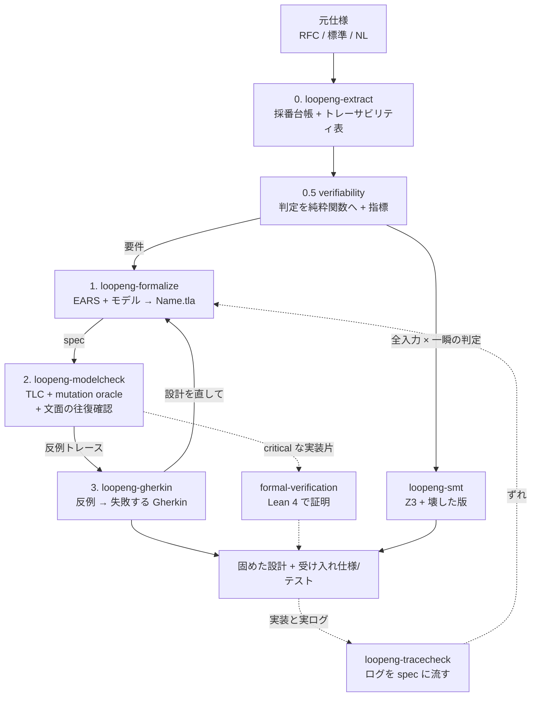

# Loop Engineering (NL → EARS → TLA+ → Gherkin)

自然言語の要求を 3 つのフィードバックループで段階的に厳密化する。
各ループは検証器を検証対象より上位層に置く。LLM が要求を構造化し、TLC が網羅探索で厳密に検査するハイブリッド。
生成物(spec / feature)は手編集せずソースから再生成する。

設計の正しさは **TLA+**(このループ)、実装そのものの数学的証明は **formal-verification(Lean 4)**。役割が違う。無理に結線しない(YAGNI)。

## 道具の選び方(必ず最初に1回)

**既定は「使わない」。** 形式手法を持ち出すのは、全入力・全順序で成り立つべき性質があり、それを手書きのテストでは網羅しきれないときだけ。迷いは「使わない」寄りに倒す。導入・学習コストは判断材料に入れない。

判断は下の問いを上から順に当てる。

1. **問いの形はどれか。**
   - 「**どんな入力でも**この判定は正しいか」「この設定は矛盾しないか」「旧形式と新形式は同じ意味か」= **全入力 × 一瞬**(状態を持たない判定)。
   - 「**どの順番で起きても**大丈夫か」「同時に来たら」「クラッシュ後は」「いつか必ず〜するか」= **全順序 × 時間**(状態遷移・並行)。
   - どちらでもない(通常の CRUD・UI・逐次のビジネスロジック)→ 通常のテスト(TDD / property-based)。ここで終わり。
2. **有限で小さく、決定的か。** 入力(または到達状態)の直積が数万程度に収まり、乱数や時刻に依存しないなら、**普通のコードで全列挙するテスト**が最も安い。ツールを持ち出す前にこれを問う。全列挙で足りればここで終わり。
3. **全入力 × 一瞬なら、決定可能な形に書けるか。** 条件が区間・集合の所属・等式・線形の整数演算・真偽の組み合わせで書けるなら **SMT 経路**([`loopeng-smt`](../loopeng-smt/SKILL.md))。書けない(非線形・確率・浮動小数の誤差が本質)なら property-based testing へ。
4. **全順序 × 時間なら、状態空間を小さく有限化できるか。** ここで落ちる方が多い。カウンタ・無制限コレクション・自由文字列・時刻・無制限リトライ回数が状態に入るなら、それらを `CONSTANT` の小さい値域(例: 最大3接続・キュー長2)に抽象化しても検証したい性質が保たれると言い切れるときだけ **TLA+ 経路**(下の 0→3 段)。「絞れそう」では起動しない。言い切れなければ property-based testing へ。

| 問いの形 | 例 | 経路 |
| --- | --- | --- |
| 全入力 × 一瞬 | 許可/拒否ルール、ターゲティング、料金・割引条件、設定の整合性、形式変換の等価性 | 全列挙 → SMT(loopeng-smt) |
| 全順序 × 時間 | 複数アクターの interleaving、ロック/キュー/リトライ、接続のライフサイクル、分割入力の結合・順序保証、判定と記録の分離、結果整合 | 全列挙 → TLA+(loopeng-formalize 以降) |
| IaC の動的側面 | create/update/replace/destroy と置換順序、依存グラフと apply 順序、並行 apply / state lock、ロールバック整合・冪等性・drift 収束、Step Functions / blue-green / フェイルオーバ | TLA+ |
| どちらでもない | 通常の CRUD・UI・逐次処理、IaC の静的宣言(命名・タグ・必須フィールド) | 通常の TDD / property-based。IaC は `terraform validate`・tflint・OPA/Conftest・`terrashark` |

各工程スキルは Skill ツールの一覧に出していない。工程に入るときは `${CLAUDE_PLUGIN_ROOT}/skills/<工程名>/SKILL.md` を Read して従う。

どの経路でも 0段(loopeng-extract)の抽出台帳と、判定ごとの境界と失敗時の意味論([`../_shared/failure-semantics.md`](../_shared/failure-semantics.md))は共通に通す。
検証の段(SMT・TLA+・実ログ突き合わせ)に入る前に、**検証容易性の段**([`../verifiability/SKILL.md`](../verifiability/SKILL.md))も共通に通す。コードがあるなら判定を小さな純粋関数に切り出して指標と reviewer の合格を得る。コードが無い設計検証でも台帳に「対象コード無し」と書き、実装が入ったら書き直す。止める入口と条件はそのスキルの「強制のしくみ」。

例外が1つある。**外部互換が目標の実装**(第三者実装・外部仕様・プロトコルの相手方と繋ぐもの)では、上の判断とは独立に、0段(loopeng-extract)だけを先に回して相手側仕様の MUST/SHOULD を全件抽出する。自分の実装を先に書いて後から相手と突き合わせると、非互換が1個ずつ芋づる式に露呈して終わらない——相手のバイト・相手の判定条件を起点に設計する。また、複数のゲート・タイマ・ポーリングが相互作用する送受信制御は「遷移の途中状態」そのものであり、TDD だけで進めると相互作用バグを実走で1個ずつ回収する羽目になる(問い1で全順序 × 時間に当たる)。

工程へ進むと決めたら、外部ライブラリやブラウザなど実物の振る舞いに頼る前提を、形式化を深める前に小さな spike で確かめる。崩れると spec と台帳の一部がやり直しになる。

## superpowers ワークフロー上の位置

- **入口は superpowers:brainstorming の Architectural パス。** アプローチを選び設計セクションの承認を得た後、spec(`docs/superpowers/specs/`)を書き上げる**前**に上の道具の選び方を掛ける。SMT か TLA+ の経路に当たればここで回し、固めた設計と正常系シナリオを spec の要件・受け入れ条件に**手法名なしで**書く(「TLA+ で検証した」とは書かない。[`../_shared/stealth-artifacts.md`](../_shared/stealth-artifacts.md))。これは設計の検証であって実装行為ではなく、成果物は git 管理外の `tasks/loopeng/` にしか置かない。Bounded パスの途中で SMT か TLA+ の経路に当たったら、それは brainstorming の言う隠れた複雑さであり、パスを Architectural に上げる。
- **重い工程はコントローラが hymme:modeler へ dispatch する**(brainstorming を進めている本人がコントローラ)。modeler は検証ワーカー: `tasks/loopeng/` に成果物を残すだけで、コミットせず、レビュアーを自分で呼ばない。superpowers:subagent-driven-development の implementer にモデル検査をさせない(implementer は subagent を生めず、検査は実装タスクではない)。
- **出口は test-design。** `.feature` は test-extract が T-ID 台帳へ転記し、superpowers:writing-plans の各 Task の失敗テストになる。

## 工程(各フェーズは専用スキルへ委譲)

| 順 | スキル | やること | 出口条件 |
| --- | --- | --- | --- |
| 0 | **loopeng-extract** | 元仕様から要件を採番チェックリスト台帳へ網羅抽出、トレーサビリティ表を立てる | 全 `S-ID` が `[x]`・欠番なし、閉じる前のチェック(信頼境界・STRIDE・CWE)が全項目埋まる |
| 0.5 | **verifiability** | 検証する判定のコードを小さな純粋関数へ切り出し、指標(CCN・行数・引数・副作用・エラーの畳み込み)を閾値まで直す | `verifiability.py` exit 0、verification-reviewer(対象 verifiability) 合格(コードが無ければ「対象コード無し」) |
| 1 | **loopeng-formalize** | EARS + 状態/ドメインモデル → `<Name>.tla`/`.cfg` | 全 EARS 行が spec の disjunct/Inv に対応 |
| 2 | **loopeng-modelcheck** | TLC で全到達状態を検査 + spec 自体を mutation testing | `No error` かつ真の survivor 0、unverified を再検査済み、文面の往復確認が終了条件を満たす([`../_shared/faithfulness-check.md`](../_shared/faithfulness-check.md)) |
| 3 | **loopeng-gherkin** | 反例 → Gherkin 機械変換、正常系シナリオ追加 | 反例が尽き「テスト」列が埋まる |
| SMT | **loopeng-smt** | 状態を持たない判定を Z3 で全入力検査、性質ごとに壊した版で検査の効きを確認 | `smt_oracle.py` exit 0、witness 全件に要件側の判断 |
| 実装後 | **loopeng-tracecheck** | 実システムの状態ログを spec に流し、許されない遷移を特定 | 代表ログが exit 0、`不一致` が全件閉じる |

外 → 中 → 内 → 直して外へ、を反例と survivor が尽きるまで回す。前段の出口条件を満たさず次へ進まない(各スキルが前提として検査する)。

**本題に広げる前に、最小例で3ループ通すことを必ず確認する。** 初回は [`references/example-counter.md`](references/example-counter.md)(Counter の 0段→3ループ完全例)をなぞってから本題の spec を書く。

## 前提ツールと成果物の置き場

- 駆動装置(tlc / loop-* / 0段ゲート hook): [`../_shared/loopeng-toolchain.md`](../_shared/loopeng-toolchain.md)。未導入なら導入を促し、勝手に大規模インストールしない。
- 生成物はすべて `tasks/loopeng/` 配下・git 管理外。管理番号・手法用語を本体に漏らさない: [`../_shared/stealth-artifacts.md`](../_shared/stealth-artifacts.md)。
- 実装への橋渡し(Lean / test-design との分担、結線チェック): [`references/bridging.md`](references/bridging.md)。
- 抽出/検査を subagent へ並列委譲するとき(基底は superpowers:dispatching-parallel-agents、hymme の差分): [`../_shared/parallel-delegation.md`](../_shared/parallel-delegation.md)。
- コード/テスト/コミット/コメントの役割分担: [`../_shared/code-comment-commit-roles.md`](../_shared/code-comment-commit-roles.md)。

## 完了前の必須ゲート(コンプライアンスレビュー)

完了扱いにする前、または「設計を検証した/網羅した」と報告する前に、**コントローラ(この工程を進めている本人)が** `hymme:verification-reviewer`(対象 `loop-engineering`) サブエージェントを dispatch して外側から検査させる。modeler に委譲していた場合も、modeler は報告して終わり、報告を受けたコントローラが呼ぶ(ワーカーは呼ばない)。
渡すもの: 0段の抽出台帳とトレーサビリティ表のパス、`.tla`/`.cfg` の場所、往復確認の入力ファイル・判定表・前件到達の証跡(`tasks/loopeng/<Name>.faithfulness-input.md` / `<Name>.faithfulness.md` / `<Name>.reach.log`)、本体ソースの場所、spec があればそのパス(手法名・管理番号の漏れ検査の対象に含める)。
レビュアーが挙げた違反(採番チェックリストの未完、台帳の欠落、STRIDE・CWE 行の未記入、往復確認の未実施・`mismatch`/`vacuous` 残り、`.tla`/`.feature` の手編集乖離、本体への管理番号・手法用語の漏れ)を解消してから完了とする。自分で「守れている」と判断して飛ばさない。
実装検証時に追加確認する2点(環境パリティ・exit code)は [`references/bridging.md`](references/bridging.md)。

## やらないこと

- 通常のユニットテストで足りる小タスクにループを持ち込まない。状態遷移・並行・プロトコルが無いなら過剰。
- 0段の抽出台帳を省いて次工程へ進まない(詳細は [`loopeng-extract`](../loopeng-extract/SKILL.md) のゲート)。
- 管理番号・手法用語を本体へ漏らさない(詳細は [`../_shared/stealth-artifacts.md`](../_shared/stealth-artifacts.md))。
